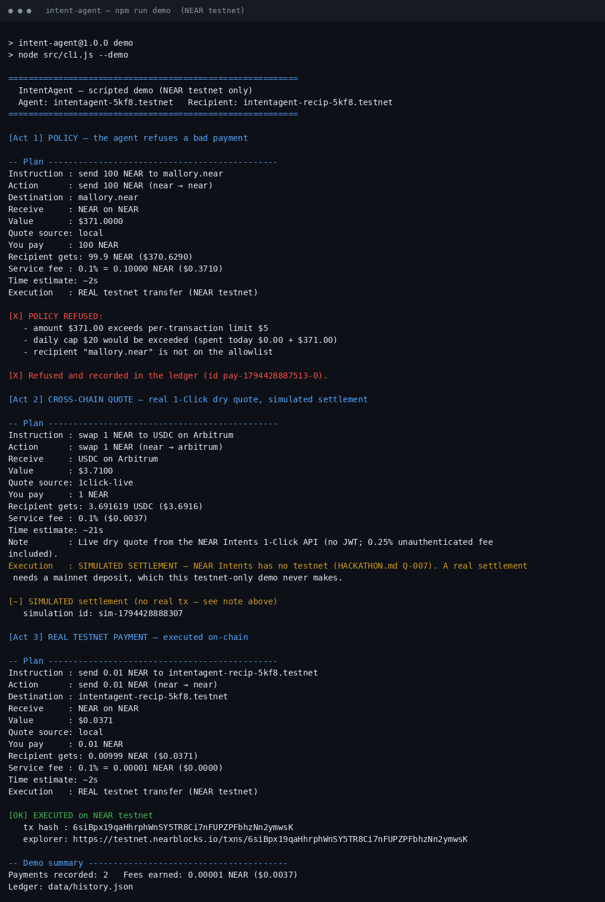
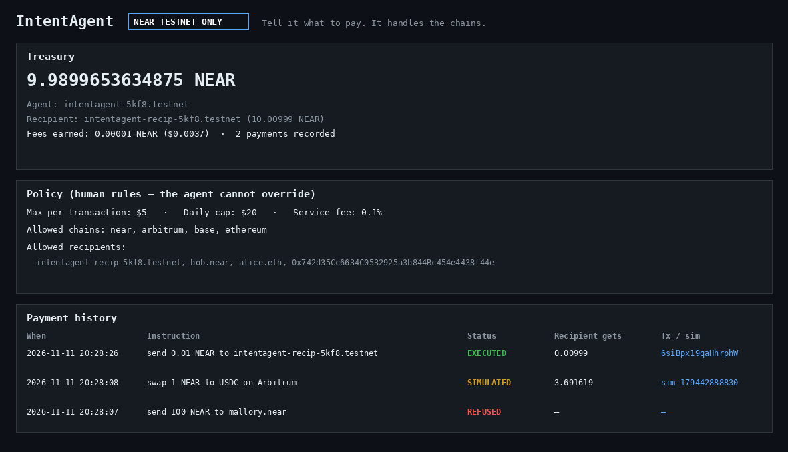

# IntentAgent — recorded demo

**Run:** 2026-11-11 ~20:28 UTC (`npm run demo`), Node v24.22.1,
near-api-js 5.1.1, express 4.22.3. Full transcript: `demo/demo-output.txt`.
Demo accounts (throwaway, testnet only): agent
`intentagent-5kf8.testnet`, recipient `intentagent-recip-5kf8.testnet`,
each funded with 10 testnet NEAR by the testnet helper.

## Act 1 — Policy: the agent refuses a bad payment

Instruction: `send 100 NEAR to mallory.near`

The plan is built and quoted, then refused for three reasons:

- amount $371.00 exceeds per-transaction limit $5
- daily cap $20 would be exceeded (spent today $0.00 + $371.00)
- recipient "mallory.near" is not on the allowlist

The refusal is recorded in the ledger (`data/history.json`,
id `pay-1794428887513-0`, status `refused`). Nothing is sent.

## Act 2 — Cross-chain quote: real 1-Click dry quote, simulated settlement

Instruction: `swap 1 NEAR to USDC on Arbitrum`

- **Quote source: `1click-live`** — a real dry quote from the NEAR Intents
  1-Click API (`POST https://1click.chaindefuser.com/v0/quote`, no JWT):
  1 NEAR → **3.691619 USDC**, $3.6916, ~21s estimate, 0.25%
  unauthenticated fee included, 0.1% IntentAgent service fee ($0.0037).
- Settlement is **simulated** (`sim-1794428888307`) and labeled as such:
  NEAR Intents has no testnet (HACKATHON.md Q-007), and this demo never
  makes a mainnet deposit. No fake tx hash is shown anywhere.

The same live-quote path was verified separately for
`pay 5 USDC on Base to alice.eth` — ENS resolved to
`0xcd2E72aEBe2A203b84f46DEEC948E6465dB51c75`, live quote
5 USDC → 4.992037 USDC on Base, ~22s estimate.

## Act 3 — Real testnet payment: executed on-chain

Instruction: `send 0.01 NEAR to intentagent-recip-5kf8.testnet`

- **Tx hash:** `6siBpx19qaHhrphWnSY5TR8Ci7nFUPZPFbhzNn2ymwsK`
- **Explorer:** https://testnet.nearblocks.io/txns/6siBpx19qaHhrphWnSY5TR8Ci7nFUPZPFbhzNn2ymwsK
- **Independent RPC verification** (after the run, via near-api-js
  `txStatus` on `rpc.testnet.near.org`):
  - status: `{"SuccessValue": ""}` — success
  - receiver: `intentagent-recip-5kf8.testnet`, action: `Transfer`
  - recipient balance: 10 → **10.00999 NEAR** (received exactly
    0.01 minus the 0.1% service fee = 0.00999)
  - agent balance: 10 → 9.9899653634875 NEAR (0.00999 sent + gas)

Demo totals: 2 payments recorded, fees earned **0.00001 NEAR ($0.0037)**.

## Screenshots





The CLI image renders the exact bytes of `demo/demo-output.txt`. The
dashboard image renders live values fetched from the running dashboard's
own API (`/api/status` + `/api/history`) — the dashboard itself is a
working Express app (`npm start`, http://localhost:3000). Both were
rendered with PIL because headless Chrome is unavailable in this sandbox;
nothing in either image is mocked or hand-written.

## Reproduce it

```sh
npm install
npm run create-account   # fresh throwaway testnet accounts, policy updated
npm run demo             # same three acts, new real testnet tx
```

Fresh checkouts create their own demo accounts (new random suffix), so
your tx hash and account names will differ — the flow is identical.
