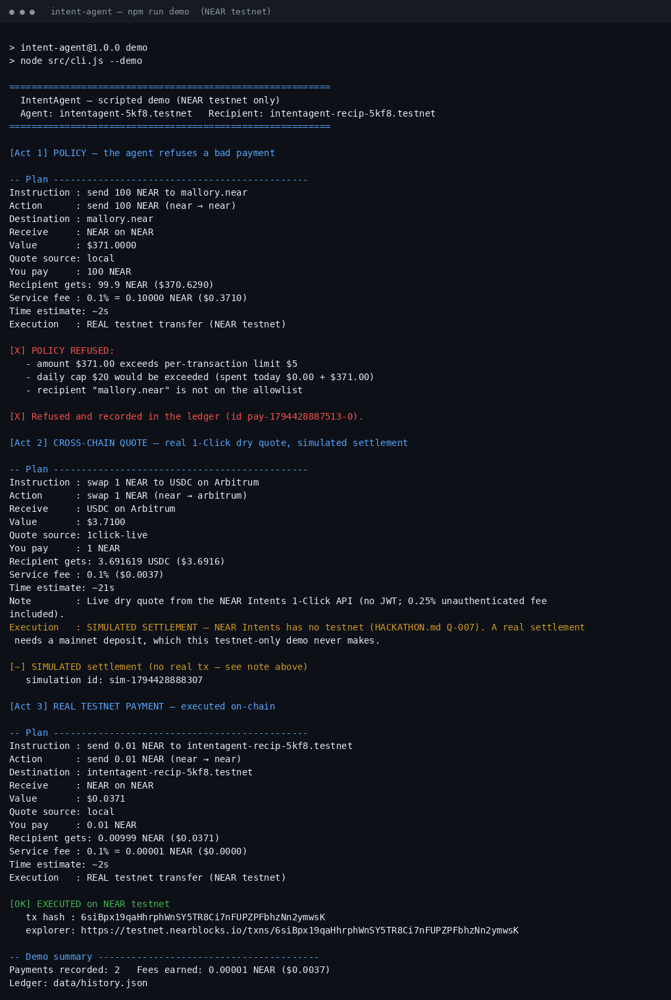
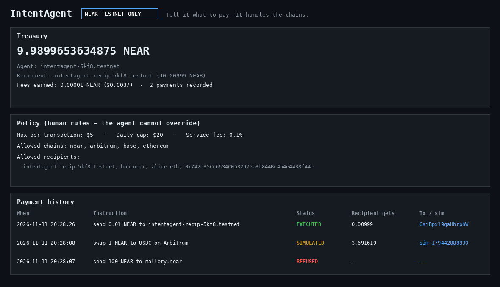

# IntentAgent — "Tell it what to pay. It handles the chains."

A natural-language autonomous payment agent on NEAR. You (or another agent)
say what to pay in plain English; IntentAgent plans it, gets a real
cross-chain quote from the **NEAR Intents 1-Click API**, checks it against
**your** policy, and only then executes — and it earns a small service fee
on every payment it runs.

**Tracks:** Agent Economy (primary) · Autonomous Business · AI Security & Defense · Unstoppable DeFi
**Repo:** https://github.com/Lacrade6/intent-agent
**Built for:** NEAR HACKATHON (Nov 1–14, 2026)

## The problem

AI agents are starting to earn and spend money on their own — paying for
APIs, data, and other agents' work. But today an agent with a wallet is an
all-or-nothing risk: give it your keys and it can drain the treasury; don't
give it keys and it can't pay for anything. IntentAgent is the middle path:
the agent holds the keys, but **the human holds the rules**.

## What it does

1. **Understands plain instructions** — `send 0.1 NEAR to bob.near`,
   `swap 2 NEAR to USDC on Arbitrum`, `pay 5 USDC on Base to alice.eth`
   (ENS names are resolved to addresses). It never guesses: a missing chain
   or an unknown asset is a clarification question, not a guess.
2. **Quotes for real** — cross-chain swaps get a live dry quote from the
   NEAR Intents 1-Click API (no JWT needed; 0.25% unauthenticated fee).
   Same-chain NEAR payments get a local quote.
3. **Enforces a human policy engine** — max amount per transaction, daily
   spend cap, allowlisted recipient addresses and chains. A violating
   payment is **refused with a clear reason** and recorded in an audit
   ledger. The agent cannot override the policy.
4. **Executes only after explicit confirmation** — CLI prompt or an
   Approve button in the dashboard.
5. **Earns a service fee** — 0.1% by default, configurable in
   `policy.json`. On NEAR transfers the fee is real: the recipient gets
   `amount − fee` and the fee stays in the agent's account.
6. **Dashboard** — treasury balance, editable policy, payment form, and
   full history with explorer links.

## NEAR tech used

- **NEAR Intents 1-Click API** (`https://1click.chaindefuser.com/v0`) —
  `GET /v0/tokens` (live token list + prices) and `POST /v0/quote`
  (dry quotes, no JWT). Endpoints verified live on 2026-11-11.
- **NEAR testnet + near-api-js v5** — real on-chain transfers, real tx
  hashes, verified on the testnet explorer.
- **ENS resolution** for `pay … to alice.eth` (public resolver,
  `api.ensideas.com`).

## What is real vs simulated — read this first

| Piece | Status |
|---|---|
| NEAR → NEAR payment on testnet | **REAL.** Executed on-chain, tx hash + explorer link below. |
| Cross-chain quote (NEAR → USDC on Arbitrum/Base) | **REAL.** Live dry quote from the 1-Click API. |
| Cross-chain settlement | **SIMULATED and labeled.** NEAR Intents has no testnet (HACKATHON.md Q-007); a real settlement needs a mainnet deposit, which this testnet-only demo never makes. Simulated legs carry a `sim-…` id, never a fake tx hash. |
| Policy refusal | **REAL.** Checked before any quote is acted on; refusals are recorded. |
| Service fee on NEAR transfers | **REAL.** Recipient receives `amount − fee`; the fee stays with the agent. |

## Verified demo result (2026-11-11, `npm run demo`)

Real testnet payment — `send 0.01 NEAR to intentagent-recip-5kf8.testnet`:

- **Tx hash:** `6siBpx19qaHhrphWnSY5TR8Ci7nFUPZPFbhzNn2ymwsK`
- **Explorer:** https://testnet.nearblocks.io/txns/6siBpx19qaHhrphWnSY5TR8Ci7nFUPZPFbhzNn2ymwsK
- **Verified on-chain via RPC:** status `SuccessValue`, receiver
  `intentagent-recip-5kf8.testnet`, action `Transfer`. Recipient balance
  10 → **10.00999 NEAR** (0.01 minus the 0.1% fee). Agent balance
  10 → 9.9899653634875 NEAR (payment + gas).
- Live 1-Click quote in the same run: 1 NEAR → **3.691619 USDC on
  Arbitrum**, ~21s estimate, source `1click-live`.
- Policy refusal in the same run: `send 100 NEAR to mallory.near`
  refused for three reasons (over $5/tx limit, over $20/day cap,
  recipient not allowlisted) and recorded.

Full transcript: `demo/demo-output.txt`. Full write-up: `DEMO.md`.




> Screenshots were rendered from the real demo transcript and live
> dashboard API data (headless Chrome is unavailable in this sandbox);
> the CLI output and dashboard values are verbatim.

## Quickstart

Prerequisites: Node.js 20+.

```sh
npm install
npm run create-account   # creates a throwaway TESTNET agent + recipient
                         # account (funded with 10 testnet NEAR each by the
                         # testnet helper) and updates policy.json
node src/cli.js balance
npm run demo               # scripted demo: refusal, cross-chain quote, real payment
npm start                  # dashboard at http://localhost:3000
```

`demo-account.json` (the agent key) is gitignored and chmod 600. The repo
ships **no** account and **no** key — every checkout creates its own
throwaway testnet accounts. Nothing here touches mainnet or real money.

## Do X, see Y (judge walkthrough)

| # | Do this | You should see |
|---|---|---|
| 1 | `npm install` | ~118 packages install, no errors |
| 2 | `npm run create-account` | Two new `*.testnet` accounts printed; `demo-account.json` created (gitignored); `policy.json` allowlist updated to the new recipient |
| 3 | `node src/cli.js balance` | Agent 10 NEAR, recipient 10 NEAR (testnet) |
| 4 | `node src/cli.js --quote "swap 1 NEAR to USDC on Arbitrum"` | Live 1-Click dry quote, `Quote source: 1click-live`, ~3.7 USDC out, 0.1% fee, ~21s estimate, `SIMULATED SETTLEMENT` note |
| 5 | `node src/cli.js --quote "pay 5 USDC on Base to alice.eth"` | `Resolved: 0xcd2E…c75 (ENS)`, live quote to USDC on Base |
| 6 | `node src/cli.js --quote "send 100 NEAR to mallory.near"` | `POLICY REFUSED` with three reasons; refusal recorded in `data/history.json` |
| 7 | `node src/cli.js --quote "send 5 USDC to 0x742d…44e"` | Clarification request — the agent refuses to guess the chain |
| 8 | `npm run demo` | Act 1 refusal, Act 2 live quote + simulated settlement, Act 3 **real testnet tx with hash + explorer link** |
| 9 | `npm start` → http://localhost:3000 | Dashboard: live balance, editable policy, payment form, history with explorer links |

## CLI reference

```sh
node src/cli.js "send 0.1 NEAR to bob.near"   # plan + quote, asks to confirm
node src/cli.js --yes "send 0.1 NEAR to bob.near"
node src/cli.js --quote "swap 1 NEAR to USDC on Arbitrum"  # quote only
node src/cli.js --demo        # scripted 3-act demo
node src/cli.js balance       # treasury balances
node src/cli.js history       # payment ledger (JSON)
node src/cli.js policy        # current policy
```

Supported instructions: `send <amount> <ASSET> to <near-account>`,
`swap <amount> <ASSET> to <ASSET> on <CHAIN>`,
`pay <amount> <ASSET> on <CHAIN> to <address|ens-name>`.
Chains: NEAR, Ethereum, Arbitrum, Base, Optimism, Polygon, BNB Chain.
Assets: NEAR, USDC, ETH (resolved from the live 1-Click token list).

## Dashboard + API

`npm start` serves the dashboard on port 3000 (override with `PORT`).

- `GET /api/status` — agent, balances, policy, fees earned
- `GET /api/history` — payment ledger (newest first)
- `GET /api/policy` · `POST /api/policy` — read/update the policy
- `POST /api/plan {text}` — parse + policy + quote (no execution; returns a `planId`)
- `POST /api/execute {planId}` — execute a pending plan (5-minute expiry)

## Policy (`policy.json`)

```json
{
  "maxPerTxUsd": 5,
  "dailyCapUsd": 20,
  "allowedChains": ["near", "arbitrum", "base", "ethereum"],
  "allowedRecipients": ["intentagent-recip-5kf8.testnet", "bob.near", "alice.eth", "0x742d35Cc6634C0532925a3b844Bc454e4438f44e"],
  "serviceFeeBps": 10,
  "demoEvmRecipient": "0x742d35Cc6634C0532925a3b844Bc454e4438f44e",
  "quoteRefundTo": "intents.near"
}
```

Notes: `bob.near` / `alice.eth` are demo personas in the allowlist; on
testnet, real transfers only succeed to existing accounts (the agent checks
this before sending). `quoteRefundTo` is a quote-request field the 1-Click
service validates against mainnet accounts; dry quotes never move funds,
so a well-known existing mainnet account is used as the placeholder — the
demo has no mainnet account by design. `demoEvmRecipient` is the
placeholder destination address used for dry swap quotes.

## Project structure

```
src/
  cli.js          CLI entry (parse → plan → confirm → execute)
  server.js       Express dashboard + JSON API
  agent.js        orchestration: parse → policy → quote → execute
  parse.js        deterministic intent parser (no LLM needed for the grammar)
  quote.js        1-Click API client (tokens, quote with retries, price-estimate fallback)
  policy.js       policy engine
  assets.js       chain/asset registry, amount math
  near.js         near-api-js testnet helpers
  ledger.js       append-only payment history (data/history.json)
  public/         dashboard UI (single file, no build step)
scripts/
  create-demo-account.js   throwaway testnet accounts via the testnet helper
  render-screenshots.py   renders docs/screenshots from real output + live API data
policy.json       human policy (editable in the dashboard)
demo/             recorded demo transcript
docs/screenshots  CLI + dashboard images
```

## Security notes

- Testnet only. No mainnet code path exists for execution.
- The agent key is in `demo-account.json`, gitignored, chmod 600.
- The policy is the trust boundary: per-tx limit, daily cap, chain and
  recipient allowlists. Refusals are logged.
- Cross-chain quotes are `dry: true` only. No deposit is ever sent to
  the 1-Click service from this demo.
- The 1-Click quote service is occasionally slow/flaky (observed 500s
  and 25s timeouts during development); the client retries 3× and falls
  back to an estimate computed from live token prices, labeled
  `price-estimate` — never silently presented as a live quote.

## License

MIT — see `LICENSE`.
